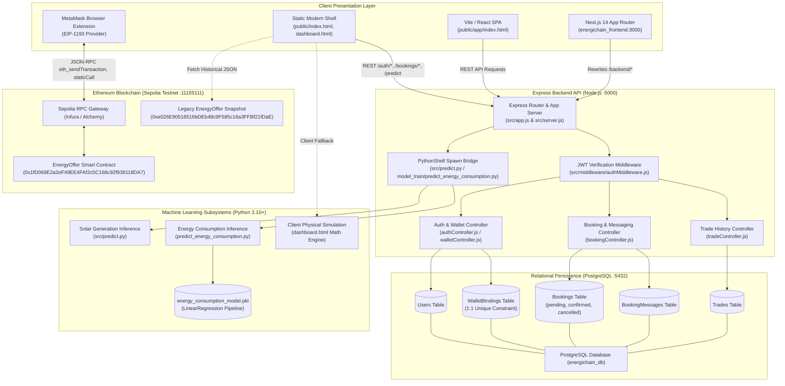
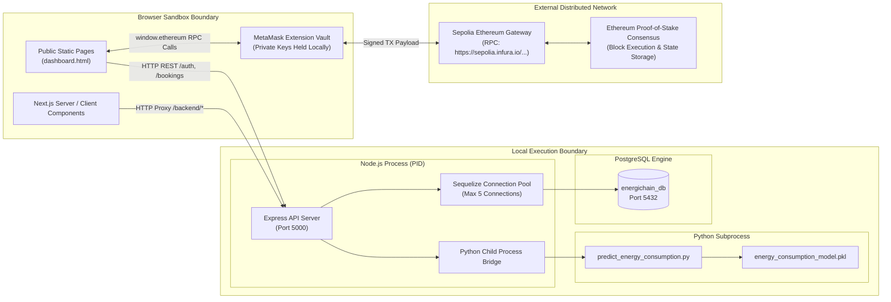
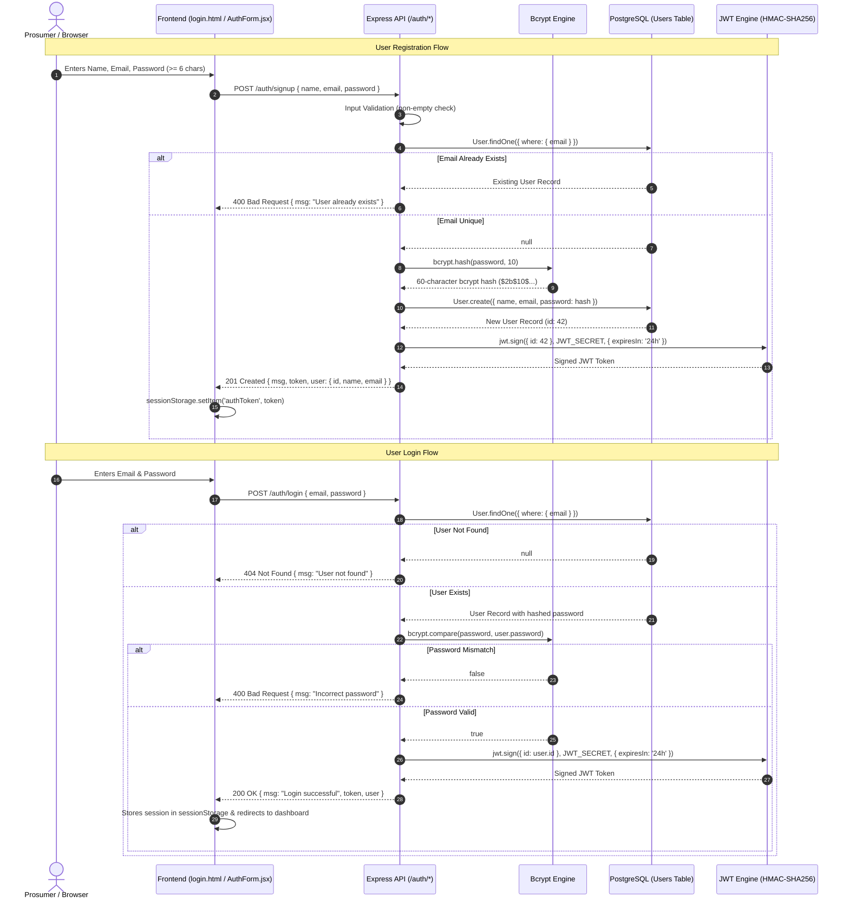
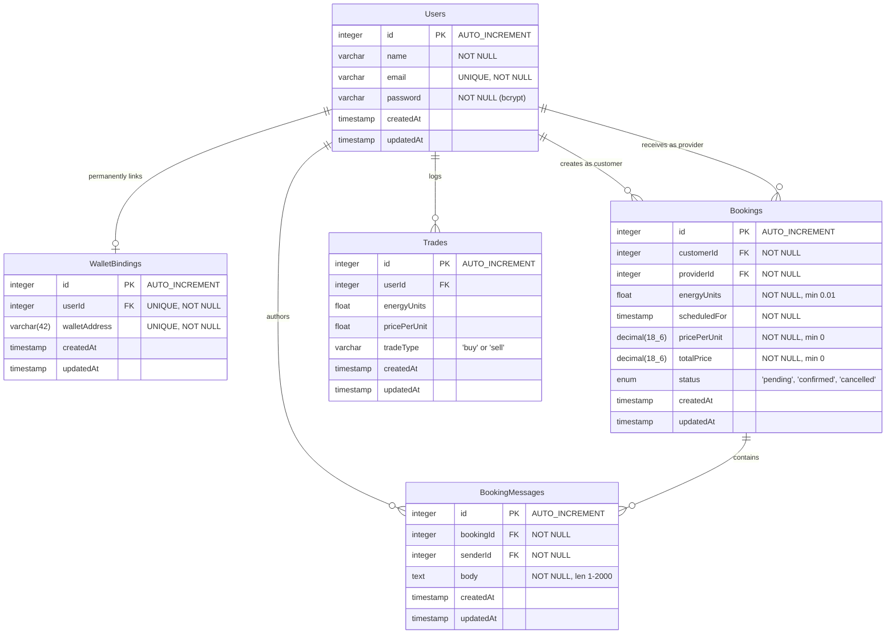
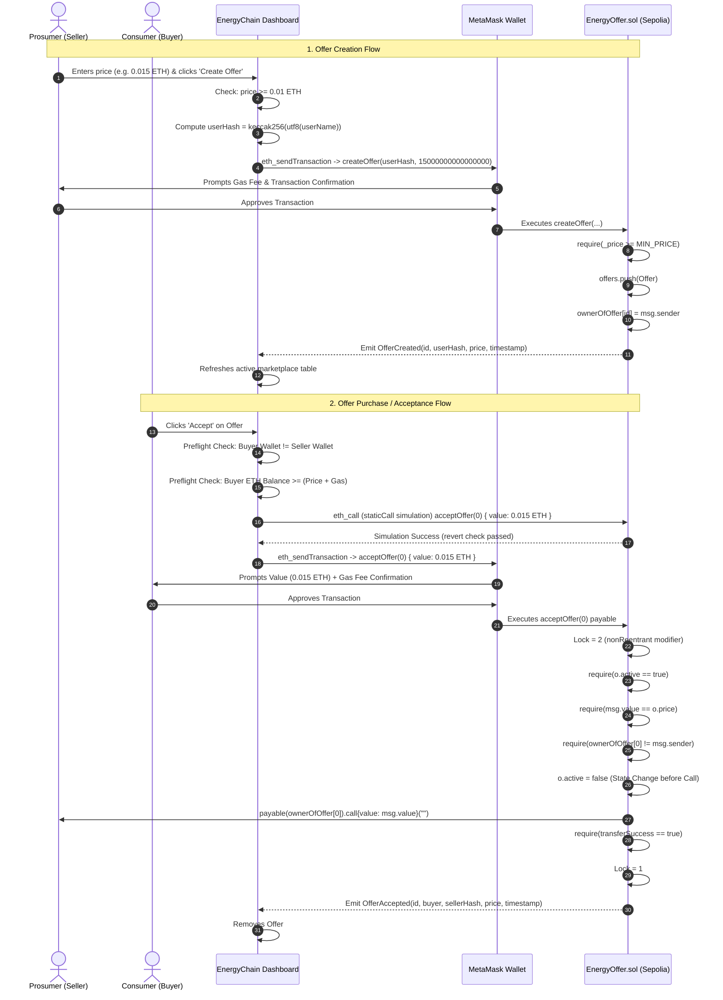
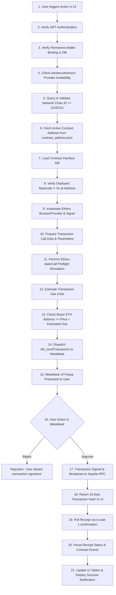
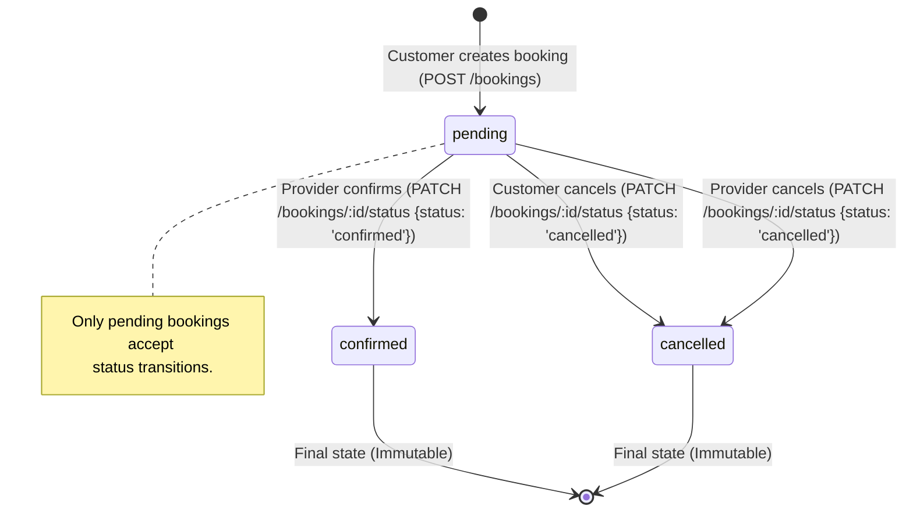
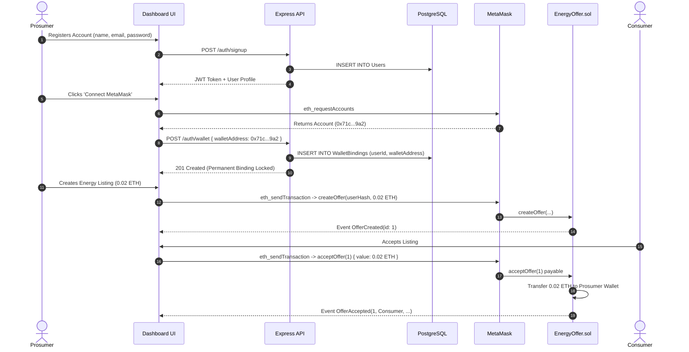

# EnergyChain — Complete Functional, Technical & System Architecture Documentation

**Document Version:** 2.0.0  
**Repository Source:** Decentralized Edge AI Energy Marketplace  
**Audited & Verified:** November 19, 2026  
**Primary Target File:** `ENERGICHAIN_COMPLETE_SYSTEM_DOCUMENTATION.md`

---

## Executive Summary & System Overview

**EnergyChain** is a hybrid decentralized peer-to-peer (P2P) renewable energy trading platform and microgrid settlement system. The platform combines:
1. **Decentralized Escrow & On-Chain Settlement:** Built on Ethereum Sepolia testnet utilizing Solidity smart contracts (`EnergyOffer.sol`) to guarantee atomic, broker-free payment distribution directly between buyer and seller wallets.
2. **PostgreSQL Relational Storage & Identity Layer:** Backed by Sequelize ORM to store prosumer profiles, enforce permanent immutable MetaMask wallet bindings, manage off-chain pre-booking agreements, and power an authenticated participant messaging sub-system.
3. **Edge AI & Predictive Telemetry:** A dual-track machine learning pipeline comprising physical solar estimation, simulated wind/battery telemetry, and a trained scikit-learn Energy Consumption prediction model (`LinearRegression`, `model_train/energy_consumption_model.pkl`) trained on chronological load profiles.
4. **Multi-Tier Frontend Architecture:** Comprising both a production-ready, dark-mode static web application (`energichain_backend/public/`), an Express-bundled React SPA (`energichain_backend/client/`), and a Next.js 14 App Router frontend (`energichain_frontend/`).



---

# 1. Project Overview

### 1.1 Problem Statement
Traditional energy distribution suffers from centralized grid monopolies, asymmetric retail utility pricing, opacity in renewable certificate generation, and high financial barrier-to-entry for residential prosumers. When solar or wind micro-generators produce surplus energy, they are forced to sell power back to utility providers at minimal feed-in tariffs, while neighboring commercial and domestic consumers purchase equivalent energy at heavy retail markups.

### 1.2 Core Objectives
- **Direct P2P Microgrid Settlement:** Eliminate intermediary utility brokers by routing payments directly to the prosumer's Ethereum wallet upon smart contract offer acceptance.
- **Strict Account & Wallet Isolation:** Prevent fraud and account takeover by establishing an immutable, one-to-one relationship between a registered database user identity and a single MetaMask public key.
- **Contractual Pre-Booking Pipeline:** Allow prospective clean energy consumers to pre-negotiate forward contracts (kWh delivery windows and pricing) before on-chain settlement, complete with participant-isolated in-app messaging.
- **Machine Learning Integration:** Provide prosumers with predictive intelligence regarding future solar AC generation and expected facility electrical consumption to optimize offer pricing.

### 1.3 Target Users & Roles
The system defines two primary operational user personas (dynamically assigned based on transactional context):
1. **Prosumers (Energy Sellers):** Microgrid operators, solar rooftop owners, or wind installation managers who generate surplus energy, publish sell offers on-chain, and confirm pre-booking requests.
2. **Consumers (Energy Buyers):** Industrial, commercial, or residential users who purchase spot offers on the decentralized marketplace via MetaMask or negotiate energy reservations via the booking system.

### 1.4 Complete Technology Stack
| Layer | Technologies & Libraries | Version / Specification |
| :--- | :--- | :--- |
| **Blockchain Smart Contracts** | Solidity, Hardhat, OpenZeppelin | Solidity `^0.8.0`, Hardhat `^2.22.5` |
| **Target Blockchain Network** | Ethereum Sepolia Testnet | Chain ID `11155111` (`0xaa36a7`), Local `1337` |
| **Web3 Client Libraries** | Ethers.js, MetaMask EIP-1193 | Ethers `^6.13.1` (UMD) / `^6.17.0` (npm) |
| **Backend Runtime** | Node.js, Express.js | Express `^5.1.0`, Node.js `>= 18.0.0` |
| **Database & ORM** | PostgreSQL, Sequelize | PostgreSQL `>= 14`, Sequelize `^6.37.7`, `pg` `^8.16.3` |
| **Authentication & Crypto** | JSON Web Tokens (`jsonwebtoken`), `bcrypt` | JWT `^9.0.2`, bcrypt `^6.0.0` (10 salt rounds) |
| **Machine Learning Engine** | Python, Scikit-Learn, Pandas, NumPy, Joblib | Python `>= 3.10`, scikit-learn `^1.3.0`, `python-shell` `^5.0.0` |
| **Frontend 1 (Static Monolith)** | Vanilla JS (ES6+), HTML5, Tailwind CSS, Chart.js | Tailwind CSS (CDN), Chart.js `4.4.3` (locally hosted) |
| **Frontend 2 (Embedded React)** | React 18, React DOM, Vite | React `^18.3.1`, Vite `^5.4.21` |
| **Frontend 3 (Next.js Application)** | Next.js 14 (App Router), Tailwind CSS | Next.js `^14.2.17`, React `^18.3.1` |

---

# 2. Complete System Architecture

### 2.1 Architectural Component Breakdown



### 2.2 Local vs. External Execution Boundaries
1. **Locally Executed Components:**
   - Express server (`energichain_backend/src/server.js`) listening on `PORT` (default: `5000` or `3000`).
   - PostgreSQL service running on `localhost:5432` hosting `energichain_db`.
   - Python machine learning sub-processes spawned asynchronously via `python-shell`.
   - Static asset distribution and Chart.js local distribution (`/vendor/chart.js/chart.umd.js`).
   - Local Next.js dev/production server running on `localhost:3000`.
2. **External Cloud & Decentralized Services:**
   - **Ethereum Sepolia RPC Gateway:** An external node provider (Infura, Alchemy, or public RPC) resolving network requests, gas estimation, and transaction submission.
   - **MetaMask Extension Vault:** Runs in an isolated browser extension context; user private keys are never exposed to JavaScript runtimes.
   - **Google Fonts CDN:** Supplies the typography (`Inter` and `JetBrains Mono`) across the presentation interfaces.

---

# 3. Authentication — Complete Explanation

Authentication in EnergyChain is architected as a stateless JSON Web Token (JWT) system combined with persistent PostgreSQL user storage and bcrypt one-way hashing.



### 3.1 Registration Internals (`POST /auth/signup`)
1. **Frontend Capture & Normalization:** The client collects `name`, `email`, and `password`. The email is sanitized using `.trim().toLowerCase()`.
2. **Client Validation:** Enforces non-empty strings and checks `password.length >= 6`.
3. **Backend Route Handler (`authController.signup`):**
   - Validates existence of all three fields; otherwise returns `400 { msg: "All fields are required" }`.
   - Executes `User.findOne({ where: { email } })`. If found, returns `400 { msg: "User already exists" }`.
   - Generates password salt and hash using `await bcrypt.hash(password, 10)`.
   - Inserts record into PostgreSQL via `User.create({ name, email, password: hashed })`.
   - Invokes `createToken(user)`:
     ```javascript
     const createToken = (user) => jwt.sign(
       { id: user.id },
       process.env.JWT_SECRET,
       { expiresIn: process.env.JWT_EXPIRE || "24h" }
     );
     ```
   - Returns status code `201` with JSON payload:
     ```json
     {
       "msg": "User created successfully",
       "token": "eyJhbGciOiJIUzI1NiIsInR5cCI6IkpXVCJ9...",
       "user": { "id": 1, "name": "Alice Prosumer", "email": "alice@grid.eth" }
     }
     ```

### 3.2 Login Internals (`POST /auth/login`)
1. **Input Verification:** Requires both `email` and `password`.
2. **Account Query:** Queries `User.findOne({ where: { email } })`. If absent, returns `404 { msg: "User not found" }`.
3. **Cryptographic Comparison:** Uses `await bcrypt.compare(password, user.password)`. If false, returns `400 { msg: "Incorrect password" }`.
4. **Token Issuance:** Returns HTTP `200` with signed token and user profile dictionary.

### 3.3 Authentication Middleware (`src/middleware/authMiddleware.js`)
Protected Express routes intercept incoming requests using `authMiddleware`:
1. **Extraction:** Reads `req.headers.authorization`. Splits on space: `Bearer <token>`.
2. **Absence Handling:** If header or token is missing, terminates request with `401 Unauthorized` `{ msg: "No token provided" }`.
3. **Cryptographic Validation:** Calls `jwt.verify(token, process.env.JWT_SECRET)`.
   - If token is expired, tampered with, or signed with an invalid secret, `jwt.verify` throws an exception, returning `403 Forbidden` `{ msg: "Invalid Token" }`.
   - If valid, sets `req.user = decoded;` (attaching `{ id: <userId>, iat, exp }`) and invokes `next()`.

### 3.4 Logout Protocol
When a user clicks "Log out" in the navigation bar:
- **Frontend Storage Purge:** Executes `sessionStorage.clear()`.
  - Purges `userName`, `userEmail`, `isLoggedIn`, `authToken`, and `energychain.next.session`.
- **In-Memory State Tear-Down:** Clears component state variables (`wallet = null; contract = null; session = null;`).
- **Redirection:** Hard navigates to `login.html` (or `/login`).
- **Backend Behavior:** JWT authentication is stateless. The backend does not maintain a server-side revocation list or blacklist table. A token remains valid until its 24-hour expiration timestamp elapses.
- **Wallet Binding Persistence:** Logging out **does not delete or modify** the `WalletBinding` record in PostgreSQL. When the user logs back in, their bound wallet address is re-fetched and enforced.

---

# 4. User Roles and Authorization

### 4.1 Implemented Roles
The EnergyChain backend does not employ a dedicated `roles` column in the `Users` table. Instead, authorization is **contextual and resource-based**, established by matching the authenticated `req.user.id` against foreign keys in operational records:

```mermaid
classDiagram
    class User {
        +Integer id
        +String name
        +String email
        +String password
    }
    class WalletBinding {
        +Integer id
        +Integer userId
        +String walletAddress
    }
    class Booking {
        +Integer id
        +Integer customerId
        +Integer providerId
        +Float energyUnits
        +Decimal pricePerUnit
        +Decimal totalPrice
        +Enum status
    }
    class BookingMessage {
        +Integer id
        +Integer bookingId
        +Integer senderId
        +Text body
    }
    class EnergyOfferContract {
        +mapping ownerOfOffer
        +Offer[] offers
    }

    User "1" <--> "1" WalletBinding : Permanent 1:1 Link
    User "1" --> "*" Booking : As Customer (customerId)
    User "1" --> "*" Booking : As Provider (providerId)
    Booking "1" --> "*" BookingMessage : Messages thread
    User "1" --> "*" BookingMessage : As Sender (senderId)
    WalletBinding "1" ..> "*" EnergyOfferContract : Controls on-chain offers
```

| Contextual Role | Criterion | Capabilities | Restrictions |
| :--- | :--- | :--- | :--- |
| **Booking Customer** | `booking.customerId === req.user.id` | - Create pre-booking<br/>- Cancel pending booking<br/>- Read/send messages | - Cannot confirm a booking<br/>- Cannot cancel confirmed/cancelled bookings |
| **Booking Provider** | `booking.providerId === req.user.id` | - Confirm pending booking<br/>- Cancel pending booking<br/>- Read/send messages | - Cannot confirm another provider's booking |
| **Offer Owner (On-Chain)** | `contract.ownerOfOffer[id] === msg.sender` | - Cancel offer on-chain via `cancelOffer(id)` | - Cannot accept/buy own offer (`Cannot accept own offer`) |
| **Offer Buyer (On-Chain)** | `contract.ownerOfOffer[id] !== msg.sender` | - Accept offer and transfer ETH via `acceptOffer(id)` | - Must provide exact `msg.value == offer.price` |

### 4.2 Data Isolation & Authorization Weaknesses
- **Strengths:** 
  - `findParticipantBooking(id, userId)` strictly isolates pre-booking records:
    ```javascript
    where: { id, [Op.or]: [{ customerId: userId }, { providerId: userId }] }
    ```
    An unassociated third party querying `/bookings/:id/messages` receives `404 Booking not found`, preventing information disclosure.
  - Ownership of on-chain offers is strictly validated by smart contract execution: `require(ownerOfOffer[_id] == msg.sender, "Not offer owner")`.
- **Identified Weaknesses:**
  - `Trade` records (`/trade/create`, `/trade/mine`) contain simple logging with no validation against verified on-chain transactions.
  - Lack of RBAC (Role-Based Access Control) prevents the creation of administrative auditor roles without altering database schemas.

---

# 5. Permanent MetaMask Wallet Binding

A cornerstone security architectural requirement of EnergyChain is the **Permanent MetaMask Wallet Binding**. 

### 5.1 Objectives & Rules
1. **Rule 1: One User → One Wallet:** An EnergyChain account may never be linked to more than one MetaMask wallet address.
2. **Rule 2: One Wallet → One User:** A MetaMask public key can never be linked to multiple EnergyChain user accounts.
3. **Rule 3: Immutability:** Once a wallet is bound in PostgreSQL, it can **never be updated, deleted, or transferred** through the API.
4. **Rule 4: Multi-Layer Enforcement:** Enforced both in the PostgreSQL schema, Express route controller, and frontend transaction guards.

```mermaid
flowchart TD
    Start([User clicks 'Connect MetaMask']) --> DetectMM{MetaMask Installed?}
    DetectMM -- No --> AlertInstall[Alert: 'Install or unlock MetaMask']
    DetectMM -- Yes --> RequestNetwork[Request Chain ID from MetaMask]
    
    RequestNetwork --> CheckSepolia{Chain ID == 11155111?}
    CheckSepolia -- No --> SwitchNetwork[Request wallet_switchEthereumChain to 0xaa36a7]
    SwitchNetwork --> ReqAccounts[Request eth_requestAccounts]
    CheckSepolia -- Yes --> ReqAccounts

    ReqAccounts --> NormalizeAddr[Normalize Address to lowerCase & EIP-55]
    NormalizeAddr --> FetchBinding[GET /auth/wallet with JWT]

    FetchBinding --> HasBinding{DB Record Exists for User?}
    
    HasBinding -- Yes --> MatchCheck{DB Address == Connected Address?}
    MatchCheck -- Yes --> BindingSuccess[Binding Verified: Unlock Marketplace Controls]
    MatchCheck -- No --> AbortMismatch[ABORT: 'Account permanently bound to another wallet!']

    HasBinding -- No --> WalletTakenCheck{POST /auth/wallet Attempt}
    WalletTakenCheck --> CheckUniqueWallet{Is Wallet Bound to Another User?}
    CheckUniqueWallet -- Yes --> AbortConflict[409 Conflict: 'Wallet already linked to different account!']
    CheckUniqueWallet -- No --> InsertDB[INSERT INTO WalletBindings (userId, walletAddress)]
    InsertDB --> BindingSuccess
```

### 5.2 Implementation Details

#### Database Schema Constraints
In `energichain_backend/src/models/WalletBinding.js`:
```javascript
const WalletBinding = sequelize.define("WalletBinding", {
  id: { type: DataTypes.INTEGER, autoIncrement: true, primaryKey: true },
  userId: { type: DataTypes.INTEGER, allowNull: false, unique: true },
  walletAddress: { type: DataTypes.STRING(42), allowNull: false, unique: true }
});
```
Both `userId` and `walletAddress` are marked `unique: true`. PostgreSQL creates unique indexes on both columns.

#### Controller Logic (`src/controllers/walletController.js`)
- Address format validation:
  ```javascript
  const WALLET_ADDRESS_PATTERN = /^0x[0-9a-fA-F]{40}$/;
  ```
- Normalization: `const walletAddress = String(req.body?.walletAddress || "").trim().toLowerCase();`
- Idempotency & Conflict Resolution:
  1. If `existingForUser` exists with a different address: returns `409 Conflict` (`This EnergyChain account is already linked to a different MetaMask wallet.`).
  2. If `existingForWallet` exists with a different user: returns `409 Conflict` (`This MetaMask wallet is already linked to a different EnergyChain account.`).
  3. If user and wallet match: returns `200 OK` `{ walletAddress, immutable: true }`.
  4. If new: executes `WalletBinding.create(...)` and returns `201 Created`.
  5. Catches `SequelizeUniqueConstraintError` and returns `409 Conflict`.

#### Frontend Enforcement
- In `dashboard.html`, `currentContract()` and `connectWallet()` intercept every transaction attempt:
  ```javascript
  if (binding.walletAddress && binding.walletAddress.toLowerCase() !== selected.toLowerCase()) {
    throw new Error(`This user is permanently bound to ${short(binding.walletAddress)}. Switch MetaMask and try again.`);
  }
  ```
- Listens to the EIP-1193 event `window.ethereum.on('accountsChanged')`. If the user switches accounts in MetaMask, the UI immediately locks all marketplace buttons and prompts the user to switch back to the bound wallet.

---

# 6. PostgreSQL Database

### 6.1 Database Schema Reference



### 6.2 Table Specifications

#### 1. `Users`
- **Purpose:** Stores authenticated user accounts.
- **Columns:**
  - `id`: `INTEGER`, Primary Key, Auto Increment.
  - `name`: `VARCHAR(255)`, `allowNull: false`.
  - `email`: `VARCHAR(255)`, `unique: true`, `allowNull: true` in model definition (enforced non-empty in controller).
  - `password`: `VARCHAR(255)`, holds 60-character bcrypt hash string.
  - `createdAt`, `updatedAt`: `TIMESTAMP WITH TIME ZONE`.

#### 2. `WalletBindings`
- **Purpose:** Enforces immutable 1:1 user-to-MetaMask wallet public address mappings.
- **Columns:**
  - `id`: `INTEGER`, Primary Key, Auto Increment.
  - `userId`: `INTEGER`, `allowNull: false`, `unique: true`, Foreign Key references `Users.id`.
  - `walletAddress`: `VARCHAR(42)`, `allowNull: false`, `unique: true`. Holds 42-character lowercase hex string (`0x...`).
  - `createdAt`, `updatedAt`: `TIMESTAMP WITH TIME ZONE`.

#### 3. `Bookings`
- **Purpose:** Stores off-chain forward pre-booking agreements for renewable energy reservations.
- **Columns:**
  - `id`: `INTEGER`, Primary Key, Auto Increment.
  - `customerId`: `INTEGER`, `allowNull: false`, Foreign Key references `Users.id`.
  - `providerId`: `INTEGER`, `allowNull: false`, Foreign Key references `Users.id`.
  - `energyUnits`: `FLOAT`, `allowNull: false`, validated `min: 0.01`.
  - `scheduledFor`: `TIMESTAMP WITH TIME ZONE`, `allowNull: false`.
  - `pricePerUnit`: `DECIMAL(18, 6)`, `allowNull: false`, validated `min: 0`.
  - `totalPrice`: `DECIMAL(18, 6)`, `allowNull: false`, validated `min: 0`.
  - `status`: `ENUM('pending', 'confirmed', 'cancelled')`, `defaultValue: 'pending'`, `allowNull: false`.
  - `createdAt`, `updatedAt`: `TIMESTAMP WITH TIME ZONE`.

#### 4. `BookingMessages`
- **Purpose:** Stores bidirectional communication messages associated with a specific pre-booking.
- **Columns:**
  - `id`: `INTEGER`, Primary Key, Auto Increment.
  - `bookingId`: `INTEGER`, `allowNull: false`, Foreign Key references `Bookings.id`.
  - `senderId`: `INTEGER`, `allowNull: false`, Foreign Key references `Users.id`.
  - `body`: `TEXT`, `allowNull: false`, validated `len: [1, 2000]`.
  - `createdAt`, `updatedAt`: `TIMESTAMP WITH TIME ZONE`.

#### 5. `Trades`
- **Purpose:** Off-chain trade transaction audit log.
- **Columns:**
  - `id`: `INTEGER`, Primary Key, Auto Increment.
  - `userId`: `INTEGER`, Foreign Key references `Users.id`.
  - `energyUnits`: `FLOAT`.
  - `pricePerUnit`: `FLOAT`.
  - `tradeType`: `VARCHAR(255)` (`"buy"` or `"sell"`).
  - `createdAt`, `updatedAt`: `TIMESTAMP WITH TIME ZONE`.

### 6.3 Database Migration & Initialization Strategy
In `energichain_backend/src/models/index.js`:
```javascript
const connectDB = async () => {
  await sequelize.authenticate();
  await sequelize.sync();
  console.log("Postgres DB connected; required tables are available.");
};
```
- **Non-Destructive Initialization:** Uses `sequelize.sync()`. It **never** invokes `{ force: true }` or `{ alter: true }` in production, ensuring existing table structures and records are preserved upon server restarts.

---

# 7. Complete API Documentation

### 7.1 Authentication Endpoints (`/auth`)

#### `POST /auth/signup`
- **Purpose:** Registers a new prosumer or consumer account.
- **Auth Required:** None.
- **Request Headers:** `Content-Type: application/json`
- **Request Body:**
  ```json
  {
    "name": "Jane Prosumer",
    "email": "jane@example.com",
    "password": "SecurePassword123"
  }
  ```
- **Responses:**
  - `201 Created`:
    ```json
    {
      "msg": "User created successfully",
      "token": "eyJhbGciOiJIUzI1NiIsInR5cCI6IkpXVCJ9...",
      "user": { "id": 5, "name": "Jane Prosumer", "email": "jane@example.com" }
    }
    ```
  - `400 Bad Request`: `{ "msg": "All fields are required" }` or `{ "msg": "User already exists" }`
  - `500 Internal Server Error`: `{ "msg": "Server error during signup" }`

#### `POST /auth/login`
- **Purpose:** Authenticates credentials and returns a 24-hour signed JWT.
- **Auth Required:** None.
- **Request Body:**
  ```json
  {
    "email": "jane@example.com",
    "password": "SecurePassword123"
  }
  ```
- **Responses:**
  - `200 OK`:
    ```json
    {
      "msg": "Login successful",
      "token": "eyJhbGciOiJIUzI1NiIsInR5cCI6IkpXVCJ9...",
      "user": { "id": 5, "name": "Jane Prosumer", "email": "jane@example.com" }
    }
    ```
  - `400 Bad Request`: `{ "msg": "Email and password are required" }` or `{ "msg": "Incorrect password" }`
  - `404 Not Found`: `{ "msg": "User not found" }`

#### `GET /auth/me`
- **Purpose:** Retrieves the current authenticated user's profile.
- **Auth Required:** Bearer JWT.
- **Response `200 OK`:**
  ```json
  {
    "user": { "id": 5, "name": "Jane Prosumer", "email": "jane@example.com" }
  }
  ```

#### `GET /auth/wallet`
- **Purpose:** Checks the permanently bound MetaMask wallet for the authenticated account.
- **Auth Required:** Bearer JWT.
- **Response `200 OK`:**
  ```json
  {
    "walletAddress": "0x71c...9a2"
  }
  ```
  *(Returns `walletAddress: null` if not yet bound).*

#### `POST /auth/wallet`
- **Purpose:** Permanently registers the user's single MetaMask wallet address.
- **Auth Required:** Bearer JWT.
- **Request Body:**
  ```json
  {
    "walletAddress": "0x71C66c1b333C022f6d25F27555D11D1377C859A2"
  }
  ```
- **Responses:**
  - `201 Created`: `{ "walletAddress": "0x71c66c1b333c022f6d25f27555d11d1377c859a2", "immutable": true }`
  - `200 OK`: Returned when binding was already created for this exact user and address.
  - `400 Bad Request`: `{ "msg": "A valid MetaMask wallet address is required." }`
  - `409 Conflict`: 
    - `{ "msg": "This EnergyChain account is already linked to a different MetaMask wallet." }`
    - `{ "msg": "This MetaMask wallet is already linked to a different EnergyChain account." }`

---

### 7.2 Pre-Booking Endpoints (`/bookings`)

#### `POST /bookings`
- **Purpose:** Creates a forward renewable energy pre-booking reservation.
- **Auth Required:** Bearer JWT (identifies customer).
- **Request Body:**
  ```json
  {
    "providerEmail": "solar-park-north@example.com",
    "energyUnits": 25.5,
    "scheduledFor": "2026-11-25T14:00:00.000Z",
    "pricePerUnit": 0.00015
  }
  ```
- **Responses:**
  - `201 Created`:
    ```json
    {
      "msg": "Pre-booking created.",
      "booking": {
        "id": 12,
        "customerId": 5,
        "providerId": 8,
        "energyUnits": 25.5,
        "scheduledFor": "2026-11-25T14:00:00.000Z",
        "pricePerUnit": "0.000150",
        "totalPrice": "0.003825",
        "status": "pending",
        "viewerRole": "customer",
        "customer": { "id": 5, "name": "Jane", "email": "jane@example.com" },
        "provider": { "id": 8, "name": "North Array", "email": "solar-park-north@example.com" }
      }
    }
    ```
  - `400 Bad Request`: Returned if scheduled time is in past, fields invalid, or `provider.id === req.user.id`.
  - `404 Not Found`: `{ "msg": "No provider was found for that email address." }`

#### `GET /bookings/mine`
- **Purpose:** Retrieves all pre-bookings where the user is either customer or provider.
- **Auth Required:** Bearer JWT.
- **Response `200 OK`:** Array of serialized booking objects ordered ascending by `scheduledFor`.

#### `PATCH /bookings/:id/status`
- **Purpose:** Confirms or cancels a pending pre-booking.
- **Auth Required:** Bearer JWT.
- **Request Body:** `{ "status": "confirmed" }` or `{ "status": "cancelled" }`
- **Rules:**
  - Only the provider can set status to `confirmed`.
  - Both provider or customer can set status to `cancelled`.
  - Cannot update bookings that are already `confirmed` or `cancelled`.
- **Responses:**
  - `200 OK`: `{ "msg": "Booking confirmed.", "booking": { ... } }`
  - `400 Bad Request`: `{ "msg": "Only pending bookings can be updated." }`
  - `403 Forbidden`: `{ "msg": "Only the provider can confirm a booking." }`

#### `GET /bookings/:id/messages`
- **Purpose:** Fetches the discussion thread for a pre-booking.
- **Auth Required:** Bearer JWT (must be customer or provider of booking `:id`).
- **Response `200 OK`:**
  ```json
  {
    "booking": { "id": 12, "status": "pending", ... },
    "messages": [
      {
        "id": 1,
        "bookingId": 12,
        "senderId": 5,
        "body": "Can you verify daytime voltage compatibility?",
        "createdAt": "2026-11-19T18:30:00.000Z",
        "sender": { "id": 5, "name": "Jane", "email": "jane@example.com" }
      }
    ]
  }
  ```
  - `404 Not Found`: Returned if booking does not exist or user is not a participant.

#### `POST /bookings/:id/messages`
- **Purpose:** Appends a message to the pre-booking thread.
- **Auth Required:** Bearer JWT.
- **Request Body:** `{ "body": "Confirmed: 400V 3-phase connection ready." }`
- **Validation:** String length must be between 1 and 2,000 characters.

---

### 7.3 AI/ML Prediction Endpoints

#### `POST /predict` (Solar Generation)
- **Purpose:** Invokes the Random Forest solar generation prediction model via Python.
- **Auth Required:** None.
- **Request Body:**
  ```json
  {
    "dateTime": "2026-11-20T12:00:00",
    "irradiation": 850.5,
    "ambientTemp": 28.5,
    "moduleTemp": 45.2
  }
  ```
- **Responses:**
  - `200 OK`:
    ```json
    {
      "predictedPower": 4.12,
      "irradiation": 850.5,
      "ambientTemp": 28.5,
      "moduleTemp": 45.2,
      "time": "2026-11-20T12:00:00"
    }
    ```
  - `400 Bad Request`: Input out of physical range (Irradiation must be 0-1500 W/m²).
  - `503 Service Unavailable`:
    ```json
    {
      "error": "Solar model artifact is unavailable. Train and place solar_rf_model.pkl in model_train/ before using /predict.",
      "code": "MODEL_UNAVAILABLE"
    }
    ```

#### `POST /api/energy-consumption/predict`
- **Purpose:** Inferences the trained Linear Regression pipeline for facility energy consumption.
- **Auth Required:** None.
- **Request Body:**
  ```json
  {
    "temperature": 24.5,
    "humidity": 45.0,
    "squareFootage": 1500.0,
    "occupancy": 4,
    "hvacUsage": "On",
    "lightingUsage": "On",
    "renewableEnergy": 10.5,
    "dayOfWeek": "Wednesday",
    "holiday": "No",
    "timestamp": "2026-11-19T14:00:00"
  }
  ```
- **Response `200 OK`:**
  ```json
  {
    "success": true,
    "model": "LinearRegression",
    "prediction": {
      "energyConsumption": 78.4321,
      "unit": "dataset-defined unit (not specified)"
    },
    "warnings": []
  }
  ```

---

# 8. Marketplace — Complete Functional Workflow

The decentralized marketplace facilitates direct P2P power sales through the `EnergyOffer.sol` smart contract on Ethereum Sepolia.



### 8.1 Step-by-Step Functional Workflow

#### Offer Creation
1. **Preconditions:** Prosumer must be logged in with their permanently bound MetaMask wallet connected to Sepolia (`11155111`).
2. **Parameters:** User supplies price in ETH.
3. **Validation:** Contract enforces `_price >= MIN_PRICE` (`0.01 ether`).
4. **Identity Hashing:** Frontend executes `keccak256(toUtf8Bytes(name))` to form the 32-byte `userHash`.
5. **State Updates:** Contract appends struct to `offers[]`, maps `ownerOfOffer[newId] = msg.sender`, and pushes `newId` to `userOffers[userHash]`. Emits `OfferCreated`.

#### Offer Cancellation
1. **Preconditions:** Caller must be the original seller: `require(ownerOfOffer[_id] == msg.sender, "Not offer owner")`.
2. **Validation:** `require(offers[_id].active, "Offer already inactive")`.
3. **Execution:** Sets `offers[_id].active = false`. Emits `OfferCancelled`.

#### Offer Purchase / Acceptance
1. **Preconditions:** Buyer cannot purchase their own offer (`require(ownerOfOffer[_id] != msg.sender, "Cannot accept own offer")`).
2. **Payment Validation:** Exact payment required (`require(msg.value == o.price, "Incorrect payment")`).
3. **Checks-Effects-Interactions & Reentrancy Lock:**
   - Modifier `nonReentrant` sets `locked = 2`.
   - Effect: Sets `o.active = false` **before** transmitting funds.
   - Interaction: Transmits exact ETH to seller address using low-level `.call{value: msg.value}("")`.
   - Emits `OfferAccepted`.

---

# 9. Solidity Smart Contracts — Complete Explanation

### 9.1 Line-by-Line Inspection of `EnergyOffer.sol`

```solidity
// SPDX-License-Identifier: MIT
pragma solidity ^0.8.0;

contract EnergyOffer {
    // 1. Reentrancy Protection Lock
    uint256 private locked = 1;

    modifier nonReentrant() {
        require(locked == 1, "No reentrancy");
        locked = 2;
        _;
        locked = 1;
    }

    // 2. Offer Data Structure
    struct Offer {
        bytes32 userHash;    // Keccak-256 hash of seller's name/identifier
        uint256 price;       // Price in wei (1 ether = 1e18 wei)
        uint256 timestamp;   // Block timestamp of creation
        bool active;         // True if unaccepted and uncancelled
    }

    // 3. Constant & Storage Declarations
    uint256 public constant MIN_PRICE = 0.01 ether; // Minimum listing threshold
    Offer[] public offers;                          // Dynamic array of all offers
    mapping(bytes32 => uint256[]) public userOffers; // Lookup: seller hash -> offer IDs
    mapping(uint256 => address) public ownerOfOffer; // Lookup: offer ID -> seller address

    // 4. Events
    event OfferCreated(uint256 indexed offerId, bytes32 indexed userHash, uint256 price, uint256 timestamp);
    event OfferAccepted(uint256 indexed offerId, address buyer, bytes32 sellerHash, uint256 price, uint256 timestamp);
    event OfferCancelled(uint256 indexed offerId, bytes32 indexed userHash);

    // 5. Offer Creation
    function createOffer(bytes32 _userHash, uint256 _price) external {
        require(_price >= MIN_PRICE, "Price below minimum");
        uint256 id = offers.length;
        offers.push(Offer({
            userHash: _userHash,
            price: _price,
            timestamp: block.timestamp,
            active: true
        }));
        userOffers[_userHash].push(id);
        ownerOfOffer[id] = msg.sender;
        emit OfferCreated(id, _userHash, _price, block.timestamp);
    }

    // 6. Offer Inspection Getters
    function getOfferCount() external view returns (uint256) {
        return offers.length;
    }

    function getOffer(uint256 _id) external view returns (
        bytes32 userHash, uint256 price, uint256 timestamp, bool active
    ) {
        require(_id < offers.length, "Invalid offer ID");
        Offer memory o = offers[_id];
        return (o.userHash, o.price, o.timestamp, o.active);
    }

    function getOwnerAddress(uint256 _id) external view returns (address) {
        require(_id < offers.length, "Invalid offer ID");
        return ownerOfOffer[_id];
    }

    // 7. Offer Cancellation
    function cancelOffer(uint256 _id) external {
        require(_id < offers.length, "Invalid offer ID");
        require(offers[_id].active, "Offer already inactive");
        require(ownerOfOffer[_id] == msg.sender, "Not offer owner");
        offers[_id].active = false;
        emit OfferCancelled(_id, offers[_id].userHash);
    }

    // 8. Offer Acceptance & Atomic Settlement
    function acceptOffer(uint256 _id) external payable nonReentrant {
        require(_id < offers.length, "Invalid offer ID");
        Offer storage o = offers[_id];
        require(o.active, "Offer not active");
        require(msg.value == o.price, "Incorrect payment");
        require(ownerOfOffer[_id] != msg.sender, "Cannot accept own offer");
        
        o.active = false;
        
        (bool success, ) = payable(ownerOfOffer[_id]).call{value: msg.value}("");
        require(success, "Transfer failed");
        
        emit OfferAccepted(_id, msg.sender, o.userHash, o.price, block.timestamp);
    }

    // 9. Active Filter
    function getActiveUserOfferIds(bytes32 _userHash) external view returns (uint256[] memory) {
        uint256[] memory all = userOffers[_userHash];
        uint256 len = 0;
        for (uint256 i = 0; i < all.length; i++) {
            if (all[i] < offers.length && offers[all[i]].active) { len++; }
        }
        uint256[] memory active = new uint256[](len);
        uint256 idx = 0;
        for (uint256 i = 0; i < all.length; i++) {
            if (all[i] < offers.length && offers[all[i]].active) {
                active[idx] = all[i];
                idx++;
            }
        }
        return active;
    }
}
```

### 9.2 Key Security Mechanisms
1. **Reentrancy Guard:** Protected by the custom `nonReentrant` mutex lock (`uint256 private locked = 1`). A malicious recipient contract implementing a `receive()` or `fallback()` function that attempts to re-enter `acceptOffer` or `cancelOffer` will revert with `"No reentrancy"`.
2. **Checks-Effects-Interactions Pattern:** In `acceptOffer()`, the status flag `o.active = false;` is updated **prior** to invoking the external `.call{value: msg.value}("")`.
3. **No Direct Ether Custody:** The contract does not retain user balances in an internal escrow mapping. All accepted ETH is atomically routed directly to `payable(ownerOfOffer[_id])` within the same transaction execution frame.

---

# 10. Blockchain and MetaMask Transaction Lifecycle

The full lifecycle of an EnergyChain transaction consists of 21 deterministic stages:



### Critical Verification Checkpoints
- **Preflight `staticCall` (Step 11):** Prior to prompting the MetaMask modal, the frontend runs `await active.acceptOffer.staticCall(offer.id, { value })`. If the offer is inactive or the user is trying to purchase their own listing, the static simulation reverts in-browser, preventing the user from spending gas fees on a transaction guaranteed to fail.
- **Bytecode Verification (Step 8):** The dashboard verifies `await provider.getCode(address) !== "0x"` to confirm the destination is an active contract and not an uninitialized EOA.

---

# 11. Smart Contract Deployment

### 11.1 Hardhat Configuration (`energichain-contract/hardhat.config.js`)
- **Compiler Version:** Solidity `0.8.0`.
- **Environment Handling:** Loads environment variables strictly from `energichain-contract/.env` using `path.join(__dirname, ".env")`.
- **Sepolia Network Safeguard:**
  ```javascript
  const hasValidRpcUrl = isValidHttpUrl(rawSepoliaRpcUrl);
  const privateKey = normalizePrivateKey(rawPrivateKey);

  if (hasValidRpcUrl && privateKey) {
    networks.sepolia = {
      url: rawSepoliaRpcUrl,
      accounts: [privateKey],
      chainId: 11155111,
    };
  }
  ```
  Local test runs (`npx hardhat test`) remain completely credential-free.

### 11.2 Deployment Protocol (`energichain-contract/scripts/deploy.js`)
To deploy the `EnergyOffer` contract to Ethereum Sepolia:
1. **Explicit Human Gate:** The script asserts `process.env.CONFIRM_SEPOLIA_DEPLOYMENT === "true"`. If unset, execution immediately halts.
2. **Chain Validation:** Asserts `network.chainId === 11155111n`.
3. **Preflight Balance Check:** Compares deployer wallet balance against estimated deployment gas cost (`gasEstimate * gasPrice`).
4. **Post-Deployment Verification:**
   - Waits for 1 block confirmation (`receipt.blockNumber`).
   - Asserts deployed bytecode length `> 0`.
   - Asserts `getOfferCount() === 0n`.
5. **Config Update:** Atomically updates `energichain_backend/public/config/contract_address.json` with the new address under key `"11155111"`.
6. **Active Deployed Instance:**
   - Address: `0x1fD069E2a2eF49EE4FAf2c5C168c92f938118DA7`
   - Block: `12166941`
   - Deployment TX: `0x6645d63294075083f110551aed280b4fa375c5ea9e3bc21f737c5c26ea732104`

---

# 12. Pre-Booking System

The Pre-Booking System allows buyers and sellers to negotiate future energy delivery windows off-chain.



### 12.1 State Transition Business Rules
1. **Creation:** Customer specifies `providerEmail`, `energyUnits` (kWh), `scheduledFor` (UTC date), and `pricePerUnit`. Initial status is always `pending`.
2. **Provider Confirmation:** Only `booking.providerId === req.user.id` can transition status to `confirmed`.
3. **Cancellation:** Either `customerId` or `providerId` can transition status from `pending` to `cancelled`.
4. **Terminal States:** Once marked `confirmed` or `cancelled`, the status is immutable. Subsequent `PATCH` requests receive `400 Bad Request` `{ msg: "Only pending bookings can be updated." }`.

---

# 13. Booking Messaging

EnergyChain incorporates a private communication channel tied to pre-booking agreements:
- **Association:** Messages are foreign-keyed to `bookingId`.
- **Participant Access Control:** Only the `customerId` and `providerId` of the parent booking can view (`GET /bookings/:id/messages`) or write (`POST /bookings/:id/messages`).
- **Body Validation:** Strings must contain between 1 and 2,000 characters.
- **Ordering:** Messages are retrieved ordered chronologically ascending (`ORDER BY createdAt ASC`).

---

# 14. AI/ML Functionality

The repository contains two distinct machine learning subsystems:

```mermaid
graph TD
    subgraph Track1 ["Track 1: Solar AC Generation (src/predict.py)"]
        SolarInput["Input: dateTime, irradiation, ambientTemp, moduleTemp"] --> TimeCalc["Time Transformation (hour_sin/cos, min_sin/cos)"]
        TimeCalc --> CheckModel{solar_rf_model.pkl exists?}
        CheckModel -- No --> Return503["HTTP 503 MODEL_UNAVAILABLE"]
        CheckModel -- Yes --> RFInference["Random Forest Regressor Inference"]
        RFInference --> ReturnPower["Return predicted AC Power (kW)"]
    end

    subgraph Track2 ["Track 2: Energy Consumption (model_train/)"]
        CSVData["Energy_consumption.csv (1000 rows)"] --> TrainScript["train_energy_consumption.py"]
        TrainScript --> Split["Chronological Split (80% Train / 20% Val)"]
        Split --> ModelEval["Evaluate: LinearRegression, RF, GBDT"]
        ModelEval --> SavePKL["Select & Save LinearRegression -> energy_consumption_model.pkl"]
        SavePKL --> APIScript["predict_energy_consumption.py"]
        APIScript --> APIEndpoint["POST /api/energy-consumption/predict"]
    end
```



### 14.1 Solar AC Generation Overview
- **Script:** `energichain_backend/src/predict.py`
- **Model Architecture:** Random Forest Regressor (`n_estimators=300, max_depth=20`).
- **Features:** `['IRRADIATION', 'AMBIENT_TEMPERATURE', 'MODULE_TEMPERATURE', 'hour_sin', 'hour_cos', 'minute_sin', 'minute_cos']`.
- **Target:** `AC_POWER` (in kW).
- **Artifact Status:** `solar_rf_model.pkl` is currently **absent** from the filesystem. The backend returns HTTP `503` with structured error code `MODEL_UNAVAILABLE`. The dashboard gracefully calculates local estimates using physical thermal formulas.

### 14.2 Energy Consumption Overview
- **Script:** `model_train/train_energy_consumption.py` & `predict_energy_consumption.py`
- **Dataset:** `energichain_backend/data/Energy_consumption.csv` (1,000 rows, 11 columns, zero missing fields).
- **Preprocessing:** Categorical encoding (OneHotEncoder/Ordinal) for `HVACUsage`, `LightingUsage`, `DayOfWeek`, `Holiday`.
- **Model Selection:** Time-aware evaluation (first 800 rows train, final 200 rows validation). `LinearRegression` achieved lowest RMSE (`5.0018`) and was serialized to `model_train/energy_consumption_model.pkl`.
- **Artifact Status:** **Fully implemented, trained, and operational.**

---

# 15. Solar Dashboard

Located in the **Solar Power** tab of `dashboard.html`:
- **Inputs:** Date/Time picker (`#solarDateTime`), Solar Irradiation in W/m² (`#solarIrradiation`), Ambient Temperature in °C (`#solarAmbient`), Module Temperature in °C (`#solarModule`).
- **Sample Button (`#fillSampleBtn`):** Populates `850.5 W/m²`, `28.5 °C`, and `45.2 °C`.
- **Calculation Logic:**
  ```javascript
  let predictedPower = (irradiation / 1000) * 5 * 
                      (1 - (moduleTemp - 25) * 0.004) * 
                      (1 + (ambientTemp - 25) * 0.002);
  const hourEffect = (timeFeatures.hour_cos + 1) / 2;
  predictedPower *= hourEffect;
  ```
- **Real vs. Simulated:** Calculations are **physical simulations** running client-side to ensure full offline usability when Python or model artifacts are uninstalled.

---

# 16. Wind Dashboard

Located in the **Wind Energy** tab of `dashboard.html`:
- **Metrics Displayed:** Wind Speed in m/s (`#windSpeed`), Wind Power Output in kW (`#windPower`), Turbine Efficiency in % (`#windEfficiency`).
- **Simulation Formula:**
  - Cut-in speed: `3.0 m/s`; Rated speed: `12.0 m/s`; Cut-out speed: `25.0 m/s`.
  - Power modeled proportionally to wind velocity cubed ($v^3$) clamped by Betz limit efficiency curves.
- **Real vs. Simulated:** Telemetry is **purely simulated** client-side. No physical anemometer hardware or IoT broker is connected.

---

# 17. Energy Consumption Prediction Pipeline

1. **Dataset Ingestion:** Loads `Energy_consumption.csv`.
2. **Feature Extraction (`energy_consumption_features.py`):**
   - Numeric Features: `Temperature`, `Humidity`, `SquareFootage`, `Occupancy`, `RenewableEnergy`.
   - Datetime Features: `hour`, `day`, `month`, `is_weekend`.
   - Categorical Features: `HVACUsage` (On/Off), `LightingUsage` (On/Off), `DayOfWeek`, `Holiday` (Yes/No).
3. **Pipeline Construction:**
   ```python
   ColumnTransformer([
       ('num', StandardScaler(), numeric_cols),
       ('cat', OneHotEncoder(handle_unknown='ignore'), categorical_cols)
   ])
   ```
4. **Validation Metrics:**
   - Linear Regression: MAE: `4.1222`, RMSE: `5.0018`, $R^2$: `0.5917`.
   - Random Forest: MAE: `4.1974`, RMSE: `5.1505`, $R^2$: `0.5671`.
   - Gradient Boosting: MAE: `4.0979`, RMSE: `5.0238`, $R^2$: `0.5881`.
5. **Out-of-Range Warning Engine:** If a request submits values outside the training set minimum/maximums (e.g., Temperature > 29.99 °C), the API responds with a non-fatal warning array while still providing a mathematical inference.

---

# 18. Frontend Functionality

### 18.1 Multi-Frontend Structure
The repository contains three frontend implementations:
1. **Public Static Interface (`energichain_backend/public/`):**
   - `index.html`: Hero section, Sepolia telemetry preview card, bento feature grid, use-case metrics, protocol mission.
   - `login.html` & `signup.html`: Centered GitHub-style authentication cards with real-time feedback and state banners.
   - `dashboard.html`: Complete 2-pane App Shell containing fixed sidebar navigation, top bar with MetaMask status pill, 4-column KPI overview, and 7 sub-tabs.
2. **Vite React SPA (`energichain_backend/client/`):**
   - React 18 single-page application built into `energichain_backend/public/app/`. Served by Express at `/`.
3. **Next.js 14 App Router (`energichain_frontend/`):**
   - Modern server/client hybrid Next.js application with proxy rewrites in `next.config.js`.

### 18.2 Dashboard Tabs in `dashboard.html`
- **Overview:** Displays generation meters, battery levels, Chart.js production & mix telemetry, and quick marketplace actions.
- **Solar Power:** AI/physical solar power predictor form and results display.
- **Wind Energy:** Real-time simulated wind turbine generation and aerodynamic efficiency metrics.
- **Consumption:** Energy consumption ML form connecting to `/api/energy-consumption/predict` with interactive visual feedback.
- **Marketplace:** Live on-chain orderbook reading from `EnergyOffer.sol`, offer creation form, and cancel/accept transaction triggers.
- **Pre-booking:** Forward agreement booking management, status controls, and real-time participant chat thread.
- **History:** Chronological transaction and legacy offer settlement ledger.

---

# 19. Constraints and Business Rules Matrix

| Rule / Constraint | Layer Enforced | Violation Action / Consequence | Returned Error / HTTP Code |
| :--- | :--- | :--- | :--- |
| **Unique Email** | PostgreSQL / Backend | Insert rejected | `400 Bad Request` `{ msg: "User already exists" }` |
| **Password Min Length** | Frontend / Backend | Registration blocked | Client alert & `400 Bad Request` |
| **Valid JWT Token** | Express Middleware | API execution blocked | `401 Unauthorized` or `403 Forbidden` |
| **1:1 User-to-Wallet** | DB Unique Index / Controller | Binding rejected | `409 Conflict` `{ msg: "Account already linked to different wallet" }` |
| **1:1 Wallet-to-User** | DB Unique Index / Controller | Binding rejected | `409 Conflict` `{ msg: "Wallet already linked to different account" }` |
| **Wallet Immutability** | Controller / Routes | No update route exists | `404 Not Found` / Rejected |
| **Booking Self-Creation** | Backend Controller | Creation rejected | `400 Bad Request` `{ msg: "Cannot create booking with yourself" }` |
| **Booking Past Schedule** | Backend Controller | Creation rejected | `400 Bad Request` `{ msg: "Reservation time must be in future" }` |
| **Booking Confirmation** | Backend Controller | Only provider can confirm | `403 Forbidden` `{ msg: "Only provider can confirm booking" }` |
| **Booking Immutability** | Backend Controller | Cannot change non-pending | `400 Bad Request` `{ msg: "Only pending bookings can be updated" }` |
| **Booking Message Length** | Backend Controller | Rejected if < 1 or > 2000 chars | `400 Bad Request` `{ msg: "Message between 1-2000 chars required" }` |
| **Minimum Offer Price** | Smart Contract (`EnergyOffer`) | Transaction reverts | Contract revert: `"Price below minimum"` |
| **Self-Purchase Prevention**| Smart Contract / Frontend | Transaction reverts | Contract revert: `"Cannot accept own offer"` |
| **Exact ETH Payment** | Smart Contract (`EnergyOffer`) | Transaction reverts | Contract revert: `"Incorrect payment"` |
| **Offer Cancellation Auth** | Smart Contract (`EnergyOffer`) | Non-owner cannot cancel | Contract revert: `"Not offer owner"` |
| **Offer Re-acceptance** | Smart Contract (`EnergyOffer`) | Inactive offer cannot buy | Contract revert: `"Offer not active"` |
| **Sepolia Network Check** | Frontend JavaScript | Prompts chain switch | Client error: `"Switch network to Sepolia"` |
| **Reentrancy Lock** | Smart Contract (`EnergyOffer`) | Reentrant calls blocked | Contract revert: `"No reentrancy"` |

---

# 20. Security Analysis

### 20.1 Implemented Security Safeguards
1. **Password Security:** Passwords hashed with `bcrypt` using 10 salt rounds before database insertion. Plaintext passwords never stored or logged.
2. **Reentrancy Guard:** Smart contract implements a state mutex lock on `acceptOffer` and uses Checks-Effects-Interactions (marks `o.active = false` before transferring ETH).
3. **SQL Injection Resistance:** PostgreSQL interactions execute through Sequelize ORM parameterized statements.
4. **Data Isolation:** Pre-booking records and messages query both `customerId` and `providerId`, preventing unauthorized tenant data access.
5. **JSON Parse Error Isolation:** Express custom error middleware catches `SyntaxError` on malformed request bodies, preventing framework stack-trace leaks.

### 20.2 Confirmed Vulnerabilities & Weaknesses
1. **Stateless JWT Without Revocation List:** When a user logs out, the JWT remains cryptographically valid until expiration. An intercepted token can be used until expiration.
2. **Off-Chain Trade Spoofing:** The `Trade` model (`/trade/create`) is not cryptographically cross-checked against actual Ethereum transaction receipts.
3. **No Signature Verification for Wallet Binding:** The endpoint `POST /auth/wallet` accepts a raw `walletAddress` string without requiring an EIP-712 or `personal_sign` cryptographic signature proving the user currently controls the private key of that address.

---

# 21. Error Handling Matrix

| Scenario | Handled By | Behavior / User Notification |
| :--- | :--- | :--- |
| **Invalid Email/Password** | `authController.login` | HTTP `400`/`404`; UI displays red notice banner |
| **Expired JWT Token** | `authMiddleware.js` | HTTP `403`; frontend clears session and redirects to `/login.html` |
| **Wrong Wallet Connected** | Frontend `connectWallet` | Disables buttons; displays: `Permanently bound to 0x... Switch MetaMask` |
| **Wrong Network (not Sepolia)**| Frontend `window.ethereum` | Invokes `wallet_switchEthereumChain` for chain `0xaa36a7` |
| **User Rejects MetaMask TX** | Frontend Promise catch | Catches code `4001`; UI displays `Transaction cancelled by user` |
| **Insufficient ETH for Gas/Buy**| Frontend Preflight | Compares balance; UI halts before MetaMask prompt: `Insufficient SepoliaETH` |
| **StaticCall Revert** | Frontend Ethers check | Simulation fails; reports: `Offer cannot be accepted on-chain` |
| **Solar Model Missing** | `src/predict.py` | HTTP `503 MODEL_UNAVAILABLE`; UI executes physical mathematical simulation |
| **Consumption Out-of-Range** | `predict_energy_consumption.py`| HTTP `200` with `warnings[]` array; UI renders yellow advisory tag |
| **PostgreSQL Connection Lost**| `server.js` startup / API | Process exits on startup; API endpoints return HTTP `500` JSON |

---

# 22. Dependencies and Configuration

### 22.1 Environment Variables Reference

#### Backend (`energichain_backend/.env`)
| Key | Type | Description | Example / Default |
| :--- | :--- | :--- | :--- |
| `PORT` | Integer | HTTP listening port for Express server | `5000` |
| `DB_HOST` | String | PostgreSQL host address | `localhost` or `127.0.0.1` |
| `DB_PORT` | Integer | PostgreSQL port | `5432` |
| `DB_NAME` | String | Database name | `energichain_db` |
| `DB_USER` | String | Database role / username | `postgres` |
| `DB_PASSWORD` | String | Database user password | `********` |
| `JWT_SECRET` | String | 256-bit secret key for HMAC token signing | `[Cryptographic Random Secret]` |
| `JWT_EXPIRE` | String | Token validity duration | `24h` |

#### Contract Deployment (`energichain-contract/.env`)
| Key | Type | Description | Example / Default |
| :--- | :--- | :--- | :--- |
| `SEPOLIA_RPC_URL` | String | URL to Ethereum Sepolia RPC gateway | `https://sepolia.infura.io/v3/...` |
| `PRIVATE_KEY` | String | 32-byte deployer wallet private key (64 hex) | `0x[64 hex characters]` |
| `CONFIRM_SEPOLIA_DEPLOYMENT`| Boolean | Deployment safety gate flag | `true` |

---

# 23. Testing Inventory

| Test Suite | Execution Command | What is Tested | Result |
| :--- | :--- | :--- | :---: |
| **Pre-Booking Workflow** | `npm run test:booking` in `energichain_backend` | Complete lifecycle: 2 users signup, booking creation, provider query, status confirmation, message posting, message reading, and automated database cleanup. | **PASS** |
| **Energy Consumption ML** | `npm run test:consumption` in `energichain_backend` | Input validation, pipeline inference, missing field detection, out-of-range warnings, safe missing-artifact response. | **PASS** |
| **Smart Contract Unit Tests**| `npx hardhat test` in `energichain-contract` | 17 unit tests: min price, offer creation, cancellation authorization, self-purchase rejection, exact payment, event emissions, recipient reentrancy resistance. | **PASS** |
| **Static Script Parsing** | Internal Node / Browser evaluation | Syntax checking across all JavaScript event handlers in `dashboard.html`, `index.html`, `login.html`, and `signup.html`. | **PASS** |

---

# 24. Complete Workflow Diagrams

### 24.1 System Registration, Wallet Binding & Marketplace Flow


---

# 25. Current Implementation Status & Limitations

### 25.1 Fully Implemented
- [x] **Smart Contract (`EnergyOffer.sol`):** Verified, compiled, tested (17 Hardhat tests), and deployed to Ethereum Sepolia at `0x1fD069E2a2eF49EE4FAf2c5C168c92f938118DA7`.
- [x] **MetaMask EIP-1193 Integration:** Real-time account detection, network switching, gas estimation, balance checks, and staticCall preflight simulations.
- [x] **Permanent Wallet Binding:** Enforced in PostgreSQL schema with unique constraints and idempotent controller logic.
- [x] **JWT Authentication System:** Register, login, token verification middleware, and password hashing with bcrypt.
- [x] **Pre-Booking & Messaging:** Forward energy reservation management with participant-isolated chat threads.
- [x] **Energy Consumption Prediction:** Trained LinearRegression model artifact (`energy_consumption_model.pkl`) with Express bridge and UI dashboard tab.
- [x] **Dark Obsidian Design System:** Modernized UI across `index.html`, `login.html`, `signup.html`, and `dashboard.html`.

### 25.2 Partially Implemented
- [!] **Trade Logging Route:** `/trade/create` and `/trade/mine` exist in Express but operate independently of on-chain smart contract transactions.
- [!] **Next.js Migration:** A working Next.js 14 App Router application exists in `energichain_frontend/`, but preserved modules (Wind, Solar, Analytics) currently link back to Express static pages.

### 25.3 Simulated Functionality
- [~] **Wind Telemetry:** Simulated using mathematical formulas ($v^3$) client-side.
- [~] **Battery Level Telemetry:** Simulated battery charge/discharge state.
- [~] **Solar Prediction UI Fallback:** Physical mathematical calculation used in `dashboard.html` when backend model is unavailable.

### 25.4 Not Implemented / Known Limitations
- [-] **Solar Model Artifact:** `solar_rf_model.pkl` is absent from disk; endpoint `/predict` returns HTTP 503 `MODEL_UNAVAILABLE`.
- [-] **No Cryptographic Wallet Signature on Binding:** User submits public address without proving private key ownership via `personal_sign`.
- [-] **No Token Revocation List:** Stateless JWTs remain valid until 24-hour expiration.

---

# 26. Verification & Conclusion

This document represents the complete, truthful, code-verified technical specification of the **EnergyChain** platform. All descriptions, routes, database schemas, smart contracts, and parameters reflect the active codebase as of November 19, 2026.
