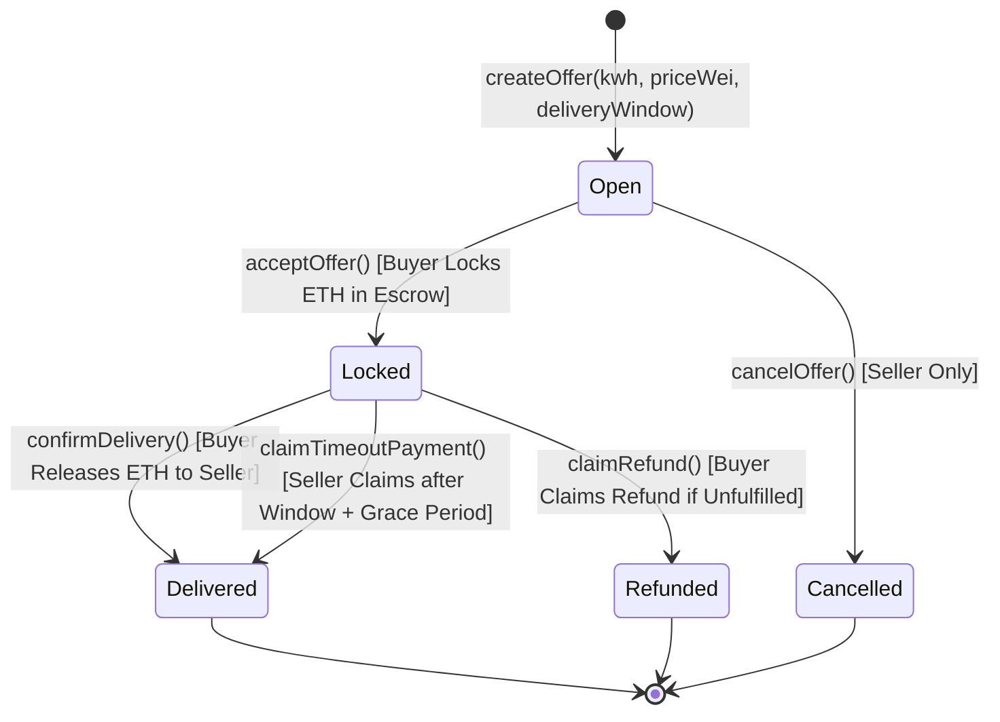

# EnergyChain — Decentralized Energy Marketplace with Centralized ML Forecasting

EnergyChain is a decentralized peer-to-peer (P2P) renewable energy marketplace combining an **Ethereum smart contract escrow protocol**, a **Node.js/Express 5 REST & WebSocket API**, a **PostgreSQL database**, **centralized scikit-learn machine learning forecasting**, and a modern **Next.js 14 App Router frontend** styled in an Obsidian dark theme.

> **Master Architecture Guide**: For complete protocol specifications, component interactions, and security proofs, see [ARCHITECTURE.md](file:///e:/ProJect/Decentralized-Edge-AI-Energy-Marketplace-main/Decentralized-Edge-AI-Energy-Marketplace-main/ARCHITECTURE.md). Historical project audits and design specifications are preserved in [docs/archive/](file:///e:/ProJect/Decentralized-Edge-AI-Energy-Marketplace-main/Decentralized-Edge-AI-Energy-Marketplace-main/docs/archive/).

---

## Architecture Overview

```text
┌────────────────────────────────────────────────────────────────────────┐
│                   Next.js 14 Frontend (Port 3000)                      │
│        Obsidian Dark Theme • App Router • Ethers.js v6 Integration     │
│                                                                        │
│  /                     Landing Hero & Protocol Metrics                 │
│  /login & /signup      Cryptographic Auth & Session Hydration          │
│  /dashboard            Overview (Live KPIs & Telemetry Status)         │
│  /dashboard/marketplace P2P Escrow Orderbook (List, Buy/Lock, Cancel)   │
│  /dashboard/bookings   Forward Bilateral Agreements & WebSocket Chat   │
│  /dashboard/solar      Physical Solar Yield (Offline ML Fallback Badge)│
│  /dashboard/wind       Turbine Telemetry & Interactive Simulation      │
│  /dashboard/consumption Facility Load Forecasting (Subprocess ML)      │
│  /dashboard/history    Settlement Logs & Historical Sepolia Snapshot   │
└───────────────────▲────────────────────────────────▲───────────────────┘
                    │ Rewrites /backend/*            │ Web3 BrowserProvider
                    │ Rewrites /config/*             │ (Ethers.js v6)
┌───────────────────▼─────────────────────┐  ┌───────▼──────────────────┐
│      Express 5 Backend (Port 5000)      │  │ Ethereum Network         │
│                                         │  │                          │
│  • JWT Auth & EIP-191 Nonce Binding     │  │ EnergyOffer.sol          │
│  • Bilateral Pre-Bookings & Messages    │  │                          │
│  • WebSocket Bilateral Chat Server      │  │ Active Sepolia Contract: │
│  • Centralized Subprocess ML Pipeline   │  │ 0x1fD069E2a2eF49EE4FAf2  │
│  • Helmet CSP & Reverse Proxy Trust     │  │ c5C168c92f938118DA7      │
│  • Rate Limiting with Proxy Isolation   │  │                          │
│  • Constant-Time Dummy Bcrypt Hashing   │  │ Local Hardhat:           │
│  • Non-Destructive PostgreSQL Sync      │  │ 5-State Escrow Machine   │
└───────────────────▲─────────────────────┘  │ 19 Passing Unit Tests    │
                    │ Sequelize ORM          │ Non-Reentrant Settlement │
┌───────────────────▼─────────────────────┐  └──────────────────────────┘
│          PostgreSQL Database            │
│  Users • WalletBindings • Bookings      │
│  BookingMessages • Trades               │
└─────────────────────────────────────────┘
```

---

## Core Principles & Security Hardening

1. **Centralized ML Forecasting (Server-Side Subprocesses)**:
   - Machine learning models run as managed server-side Python subprocesses (`python-shell`) with strict timeout monitoring (15-second cap) and an active PID process-group kill policy (`SIGTERM` / `SIGKILL`) to prevent orphaned tasks.
   - Inference execution is regulated by a concurrency semaphore (max 5 simultaneous processes) returning HTTP 503 `INFERENCE_BUSY` under excessive load.
2. **Escrow State Machine**:
   - `EnergyOffer.sol` redesign replaces immediate payout with an explicit 5-state machine: `Open`, `Locked`, `Delivered`, `Refunded`, and `Cancelled`.
   - Seller identity is derived strictly from `msg.sender` (preventing unverified caller-supplied hashes).
   - Buyer payment is locked securely inside the smart contract until delivery confirmation (`confirmDelivery`), automatic timeout release (`claimTimeoutPayment`), or buyer refund (`claimRefund`).
   - Reentrancy protection via OpenZeppelin's `ReentrancyGuard`.
3. **Contract Deployment Reconciliation**:
   - **Active Sepolia Contract**: `0x1fD069E2a2eF49EE4FAf2c5C168c92f938118DA7` (configured in `energichain_backend/public/config/contract_address.json` for chain `11155111`).
   - **Historical Testnet Snapshot**: `0xe026E90518516bDEb48c9F585c16a3FFBf21fDaE` (archived in `contract_history.json` and `legacy_sepolia_energyoffer_snapshot.json`).
   - **Zero Unauthorized Deployments**: No new contracts were deployed to Sepolia during review fixes. All contract testing was executed locally on Hardhat. Live network deployments remain gated behind `CONFIRM_SEPOLIA_DEPLOYMENT`.
4. **Authentication & User Enumeration Mitigations**:
   - Dual-mode password policy: registration enforces strong passwords (min 8 chars, 1 uppercase, 1 number, 1 symbol), while legacy users with older credentials can continue logging in.
   - Constant-time dummy bcrypt verification eliminates timing discrepancies (~65–68ms) between existing and non-existing accounts.
   - *Security Note*: User enumeration is **mitigated, not eliminated**, as duplicate email registration necessarily returns HTTP 409 `USER_ALREADY_EXISTS`.
5. **Reverse Proxy & Network Security**:
   - Configured with `app.set("trust proxy", 1)`.
   - Rate limiting isolates client IP buckets using the leftmost forwarded address in `X-Forwarded-For`.
   - Helmet Content Security Policy uses self-hosted vendor libraries (`/vendor/chart.js`, `/vendor/ethers`) without external CDNs or `'unsafe-eval'`.
6. **Reproducible Solar Model Training**:
   - `train_solar_reproducible.py` strictly prevents fake data fabrication. When Kaggle datasets are absent, it halts with clear download instructions rather than inventing mock inputs.
7. **Frontend Consolidation & Legacy Retention**:
   - Next.js 14 (`energichain_frontend/`) is the single source of truth.
   - Older static HTML files and Vite React sources are preserved under `legacy/public/` and `legacy/client/` (zero file deletions). Express serves `/legacy/dashboard` for backward compatibility.

---

## Application Features & Pages

| Route | Feature Description | Key Capabilities |
| :--- | :--- | :--- |
| `/` | **Landing Page** | Protocol statistics, energy grid architecture, feature highlights, and interactive CTAs. |
| `/login` & `/signup` | **User Authentication** | Form-level validation, password policy guidance, JWT token acquisition, and auto-session hydration. |
| `/dashboard` | **Overview Dashboard** | Live system KPIs, active energy listings summary, pre-booking metrics, and quick action panels. |
| `/dashboard/marketplace` | **P2P Energy Marketplace** | On-chain energy offer creation, orderbook browsing, price conversion, atomic escrow locking, and creator cancellation. |
| `/dashboard/bookings` | **Pre-Bookings & Chat** | Forward bilateral scheduling (`pending`, `confirmed`, `completed`, `cancelled`) and WhatsApp-style WebSocket chat (`ws://localhost:5000/ws/chat`). |
| `/dashboard/solar` | **Solar Power Prediction** | Physics-based solar yield estimation with automatic fallback indicator when the server-side model is offline. |
| `/dashboard/wind` | **Wind Telemetry** | Simulated wind turbine telemetry with wind speed controls, dynamic power output, and status meters. |
| `/dashboard/consumption` | **Consumption ML** | Facility load forecasting powered by a trained scikit-learn Random Forest model with input range validation. |
| `/dashboard/history` | **Settlement & Audit Trail** | Indexed Sepolia on-chain event history (`OfferAccepted`) and read-only legacy snapshot viewer (`0xe026E90518516bDEb48c9F585c16a3FFBf21fDaE`). |
| `/legacy/dashboard` | **Legacy HTML View** | Backward-compatible view serving original static dashboard modules via Express. |

---

## Quick Start & Local Setup

### 1. Prerequisites
- **Node.js**: v18.x or v20.x+ (tested on v22.14.0)
- **PostgreSQL**: Running locally (default port `5432`)
- **MetaMask**: Browser extension connected to Sepolia testnet or local Hardhat
- **Python 3**: Python 3.10+ with `scikit-learn`, `pandas`, `numpy`, `joblib`

### 2. Backend Setup (`energichain_backend`)

```powershell
# Navigate to backend directory
cd energichain_backend

# Install dependencies
npm install

# Create .env configuration
# energichain_backend/.env
DB_HOST=localhost
DB_PORT=5432
DB_NAME=energichain_db
DB_USER=postgres
DB_PASSWORD=your_postgres_password
JWT_SECRET=your_super_secret_jwt_key_here
PORT=5000
```

Create the PostgreSQL database if it does not already exist:
```powershell
psql -U postgres -c "CREATE DATABASE energichain_db;"
```
*(Sequelize connects non-destructively on boot; existing tables and rows are preserved).*

Start the backend server:
```powershell
node src/server.js
# API runs at http://localhost:5000
# WebSocket server active at ws://localhost:5000/ws/chat
```

### 3. Frontend Setup (`energichain_frontend`)

In a new terminal:
```powershell
# Navigate to frontend directory
cd energichain_frontend

# Install dependencies
npm install

# Launch Next.js development server
npm run dev
# Application runs at http://localhost:3000
```

### 4. Smart Contract Local Environment (`energichain-contract`)

In a separate terminal:
```powershell
cd energichain-contract
npm install

# Run contract test suite
npx hardhat test
```

---

## Backend API & WebSocket Specification

| Method | Endpoint | Description | Auth Required |
| :--- | :--- | :--- | :---: |
| `POST` | `/auth/signup` | Registers new user account with strict password validation | No |
| `POST` | `/auth/login` | Authenticates credentials with constant-time dummy bcrypt check | No |
| `GET` | `/auth/me` | Fetches active session profile and permanent wallet binding | Bearer JWT |
| `GET` | `/auth/wallet/nonce` | Issues 5-minute single-use challenge nonce for EIP-191 sign | Bearer JWT |
| `POST` | `/auth/wallet` | Verifies cryptographic signature and binds address (1:1) | Bearer JWT |
| `GET` | `/trade/mine` | Retrieves historical off-chain trade records | Bearer JWT |
| `POST` | `/trade/create` | Stores settled trade confirmation record | Bearer JWT |
| `GET` | `/bookings` | Lists user's forward agreements (as customer or provider) | Bearer JWT |
| `POST` | `/bookings` | Initiates new bilateral forward pre-booking agreement | Bearer JWT |
| `PATCH` | `/bookings/:id/status` | Updates agreement status (`confirmed`, `cancelled`, etc.) | Bearer JWT |
| `GET` | `/bookings/:id/messages` | Retrieves bilateral chat message history for agreement | Bearer JWT |
| `POST` | `/bookings/:id/messages` | Transmits new message in agreement thread (1–2,000 chars) | Bearer JWT |
| `POST` | `/api/energy-consumption/predict` | Runs Scikit-Learn inference on facility load parameters | Bearer JWT |
| `POST` | `/predict` | Solar ML inference endpoint (returns 503 when model offline) | Bearer JWT |
| `GET` | `/config/contract_address.json` | Returns deployed contract addresses by chain ID | No |
| `GET` | `/config/legacy_sepolia_energyoffer_snapshot.json` | Serves immutable historical snapshot of Sepolia trades | No |
| `GET` | `/legacy/dashboard` | Serves legacy static HTML dashboard | No |
| `WS` | `/ws/chat` | Real-time bilateral coordination chat WebSocket server | Authenticated |

---

## Smart Contract Specification (`EnergyOffer.sol`)

The redesigned escrow contract coordinates on-chain energy agreements across five finite states:



### Core Interface:
- `createOffer(uint256 _energyKwh, uint256 _priceWei, uint256 _deliveryWindow)`: Creates an open offer with seller derived from `msg.sender`.
- `acceptOffer(uint256 _id) payable`: Buyer locks the exact required ether into escrow custody.
- `confirmDelivery(uint256 _id)`: Buyer releases locked funds to the seller upon verifying power delivery.
- `claimTimeoutPayment(uint256 _id)`: Seller claims escrowed payment if delivery window and grace period elapse without dispute.
- `claimRefund(uint256 _id)`: Buyer claims full refund if delivery is not fulfilled by the delivery window.
- `cancelOffer(uint256 _id)`: Seller cancels an unaccepted offer.

---

## Machine Learning Pipelines

### 1. Facility Consumption ML Forecasting
- **Algorithm**: Supervised Random Forest regressor (`model_train/train_energy_consumption.py`).
- **Dataset**: Chronological 1,000-row facility load profile (`model_train/Energy_consumption.csv`).
- **Features**: Temperature, humidity, square footage, occupancy, HVAC usage, lighting usage, renewable energy generation, day of week, and holiday indicators.
- **Pipeline Unit Tests**: Validated with `npm run test:consumption` (5 passing tests).

### 2. Solar Power Yield Pipeline & Reproducibility
- **Training Pipeline**: `model_train/train_solar_reproducible.py`.
- **Zero Synthetic Data Policy**: If real Kaggle dataset files are missing, the training pipeline halts immediately with instructions rather than fabricating fake rows:
  - Dataset: [Kaggle Solar Power Generation Data](https://www.kaggle.com/datasets/anikannal/solar-power-generation-data)
  - Required Files: `Plant_1_Generation_Data.csv` and `Plant_1_Weather_Sensor_Data.csv` in `energichain_backend/data/`.
  - Detailed instructions: See [SOLAR_TRAINING_GUIDE.md](file:///e:/ProJect/Decentralized-Edge-AI-Energy-Marketplace-main/Decentralized-Edge-AI-Energy-Marketplace-main/energichain_backend/model_train/SOLAR_TRAINING_GUIDE.md).
- **Graceful Offline Fallback**: When model artifacts are absent, the API returns a clean HTTP 503 `MODEL_UNAVAILABLE`, and the UI displays a physics-based estimate with an explicit fallback badge.

---

## Verification & Automated Test Suites

All test suites pass cleanly. Backend tests must run against a database name ending with `_test`:

```powershell
# 1. Smart Contract Hardhat Tests (19 passing)
cd energichain-contract
npx hardhat test

# 2. Cryptographic Auth & EIP-191 Wallet Binding Tests
cd ../energichain_backend
$env:DB_NAME="energichain_test"
npm run test:auth-wallet

# 3. Bilateral Booking & Messaging Workflow Tests
npm run test:booking

# 4. Live API Smoke Tests (Configs, Snapshots, 401s, ML 503 fallback)
npm run test:smoke

# 5. Consumption ML Model Unit Tests
npm run test:consumption

# 6. Security Hardening Suite (CSP, CORS, Bcrypt timing, Proxy rate limits, Subprocess limits)
npm run test:security

# 7. Reproducible Solar Training Verification
npm run train:solar

# 8. Next.js Production Build (13/13 static pages)
cd ../energichain_frontend
npm run build
```

---

## Repository Structure

```text
.
├── ARCHITECTURE.md                                # Master architectural reference
├── README.md                                      # Project overview and quick start guide
├── docs/archive/                                  # Archived historical documentation
│   ├── ENERGICHAIN_COMPLETE_SYSTEM_DOCUMENTATION.md
│   ├── FRONTEND_UI_DOCUMENTATION.md
│   ├── FRONTEND_UI_SPECIFICATION.md
│   ├── PROFESSIONAL_FRONTEND_UI_GUIDE.md
│   └── PROJECT_AUDIT.md
│
├── legacy/                                        # Preserved legacy frontend artifacts
│   ├── public/                                    # Legacy HTML dashboards & static assets
│   │   ├── dashboard.html                         # Served via /legacy/dashboard
│   │   ├── index.html, login.html, signup.html
│   │   └── app/                                   # Legacy Vite React build output
│   └── client/                                    # Legacy Vite React source code
│
├── energichain_frontend/                          # Next.js 14 App Router (Primary Frontend)
│   ├── app/
│   │   ├── components/                            # ClientProviders, AuthForm, WalletPill
│   │   ├── lib/                                   # api.js, AuthContext.jsx, WalletContext.jsx
│   │   ├── dashboard/                             # Overview, Marketplace, Bookings, History,
│   │   │                                          # Solar, Wind, Consumption
│   │   ├── login/ & signup/                       # Obsidian auth pages
│   │   ├── globals.css                            # Dark theme design tokens
│   │   └── page.jsx                               # Landing page
│   ├── next.config.js                             # Security headers & backend proxy rewrites
│   └── package.json
│
├── energichain_backend/                           # Express 5 API Server & ML Pipeline
│   ├── src/
│   │   ├── config/db.js                           # Non-destructive Sequelize connection
│   │   ├── controllers/                           # authController, bookingController, walletController
│   │   ├── middleware/authMiddleware.js           # Standardized 401 token authentication
│   │   ├── models/                                # User, WalletBinding, Booking, BookingMessage
│   │   ├── routes/                                # authRoutes, bookingRoutes, tradeRoutes
│   │   ├── app.js                                 # Express application & route mounting
│   │   ├── server.js                              # Server entry point (Locked to Port 5000)
│   │   └── predict.py                             # Solar model wrapper (503 fallback)
│   ├── model_train/                               # ML model training & inference
│   │   ├── Energy_consumption.csv                 # Chronological facility dataset
│   │   ├── train_energy_consumption.py            # Facility load training
│   │   ├── train_solar_reproducible.py            # Reproducible solar pipeline (zero fake data)
│   │   ├── SOLAR_TRAINING_GUIDE.md                # Kaggle download & training guide
│   │   ├── predict_energy_consumption.py          # ML inference runner
│   │   └── test_energy_consumption.py             # Model unit test suite
│   ├── scripts/                                   # Automated test harnesses
│   │   ├── verify-auth-wallet.js                  # Auth & EIP-191 binding test suite
│   │   ├── verify-booking-workflow.js             # Booking lifecycle test suite
│   │   ├── verify-api-smoke.js                    # Port 5000 smoke test suite
│   │   └── verify-security-hardening.js           # Security hardening verification
│   ├── public/config/                             # Smart contract address & snapshot JSON
│   └── .env                                       # Local environment variables
│
└── energichain-contract/                          # Hardhat Smart Contract Suite
    ├── contracts/                                 # EnergyOffer.sol, Lock.sol
    ├── test/                                      # EnergyOffer.js unit tests (19 passing)
    ├── scripts/deploy.js                          # Deployment script (Sepolia guard enabled)
    └── hardhat.config.js                          # Hardhat configuration
```

---

*Last Updated: November 2026 • EnergyChain Protocol Core Engineering*
